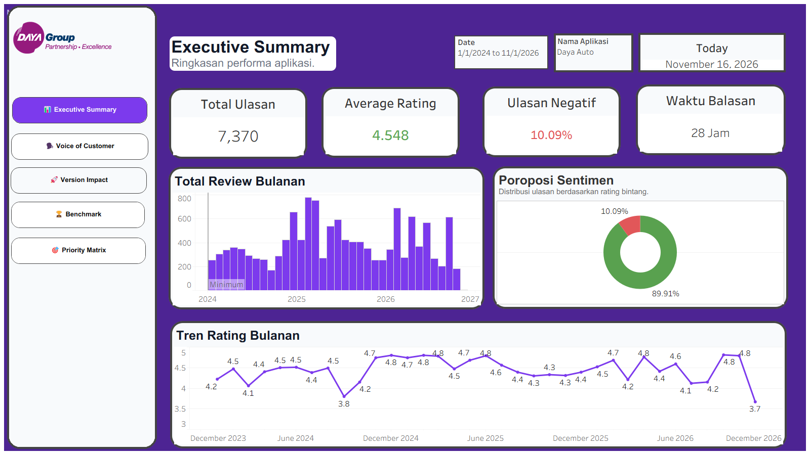
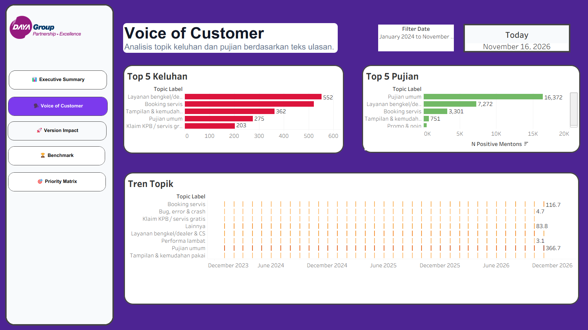
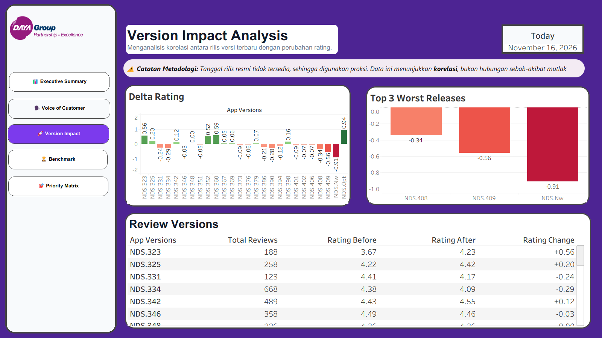
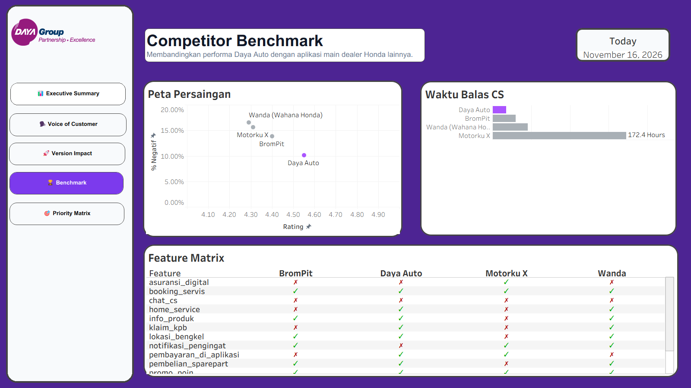
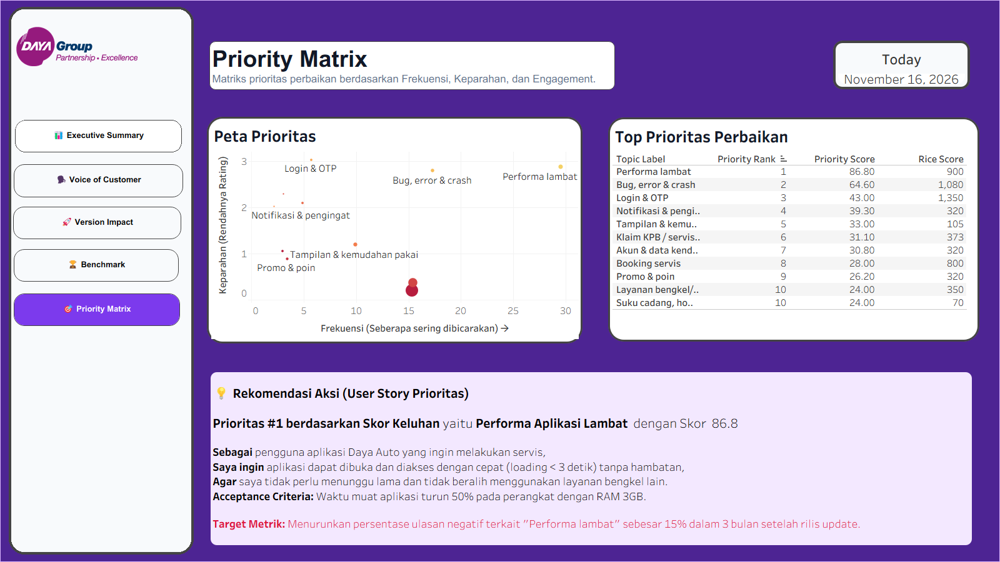

# Daya Auto Voice of Customer (VoC) Analytics
**Mengubah 28.000+ Ulasan Pengguna Menjadi Prioritas Perbaikan Aplikasi Berbasis Data**

🔗 **[Lihat Dashboard Interaktif di Tableau Public](https://public.tableau.com/app/profile/muhammad.farhan7811/viz/DayaVOC/ExecutiveSummary)**

---

## 📌 Project Overview
Proyek ini adalah analisis independen berbasis data yang bertujuan mengevaluasi pengalaman pengguna aplikasi **Daya Auto** (aplikasi main dealer Honda) dan membandingkannya dengan aplikasi kompetitor (Wanda, BromPit, Motorku X). 

Dengan mengekstraksi lebih dari **28.000 ulasan publik** dari Google Play Store, proyek ini mengubah teks keluhan yang tidak terstruktur menjadi *actionable insights* melalui *pipeline* data end-to-end. Setelah melalui proses pembersihan data (menghapus duplikat dan spam), analisis difokuskan pada **7.370 ulasan valid** untuk aplikasi Daya Auto.

## 🚨 Business Problem
Di industri purnajual otomotif, pengalaman digital adalah titik sentuh pertama pelanggan. Kegagalan teknis kecil (seperti gagal *booking* atau aplikasi *crash*) dapat memicu *churn* (beralih ke bengkel non-resmi). 

Perusahaan sering kali kesulitan menangkap sinyal-sinyal ini karena keterbatasan data internal. Ulasan publik di Google Play menyimpan "VoC" yang sangat berharga, namun volumenya terlalu besar untuk dibaca secara manual.

## 🎯 Objectives
1. Mengidentifikasi topik keluhan dan pujian utama pengguna Daya Auto.
2. Melacak dampak rilis versi aplikasi terhadap perubahan rating.
3. Melakukan *benchmarking* performa layanan digital dengan kompetitor.
4. Menyusun matriks prioritas perbaikan menggunakan metode *Scoring* dan **RICE Framework**.

## ⚙️ Methodology & Process Flow
1. **Data Extraction:** Scraping ulasan Google Play (2024–2026) menggunakan Python (`google-play-scraper`).
2. **Data Processing:** Pembersihan teks bahasa Indonesia, penanganan *slang words*, dan *masking* PII (Privasi).
3. **Data Labeling (NLP):** Klasifikasi topik berbasis kamus (*lexicon*) yang divalidasi secara manual dengan *Gold Set* (Akurasi Topik: 62.5%, Akurasi Sentimen: 69.8%).
4. **Data Warehousing:** Penyimpanan data ke PostgreSQL untuk *querying* yang kompleks.
5. **Data Visualization:** Perancangan UI/UX Dashboard 5 halaman menggunakan **Tableau Public** dan *wireframing* **Draw.io**.

## 📊 Dashboard Preview

**1. Executive Summary**
Memberikan gambaran umum metrik utama: Total ulasan, rating rata-rata, persentase ulasan negatif, dan kecepatan respons CS.

**2. Voice of Customer**
Membedah topik keluhan dan pujian, serta memetakan trennya dari bulan ke bulan menggunakan *Heatmap*.

**3. Version Impact Analysis**
Menganalisis korelasi antara rilis versi terbaru dengan perubahan rating aplikasi (menggunakan proksi tanggal).

**4. Competitor Benchmark**
Membandingkan performa Daya Auto dengan kompetitor (Peta Persaingan, Waktu Balas CS, dan Matriks Fitur).

**5. Priority Matrix**
Matriks prioritas perbaikan berdasarkan Frekuensi, Keparahan, dan Engagement, dilengkapi dengan RICE Score dan rekomendasi *User Story*.

## 💡 Key Insights
Berdasarkan analisis terhadap dataset final (7.370 ulasan Daya Auto):

*   **Tingkat Kepuasan Tinggi:** Daya Auto mencatatkan *Weighted Rating* sebesar **4.548**, dengan persentase ulasan negatif hanya **10.09%**.
*   **Masalah Utama Adalah Performa:** Topik "Performa lambat" menyumbang proporsi negatif tertinggi (**67.05%** dari total sebutan topik tersebut) dengan rating rata-rata sangat rendah (2.12). Ini adalah prioritas utama (#1) berdasarkan Skor Keparahan.
*   **Anomali Fitur Booking:** Meskipun ada keluhan (8.44%), fitur "Booking Servis" justru mendominasi pujian dengan rating yang sangat tinggi (**91.56% positif**). Ini menandakan fiturnya sangat disukai, namun segelintir pengguna mengalami *error* teknis spesifik.
*   **Keunggulan Layanan Pelanggan (CS):** Dari sisi *Benchmark*, Daya Auto adalah yang paling responsif di industri. Waktu balas median CS hanya **18 Jam**, jauh lebih cepat dibandingkan Motorku X yang memakan waktu hingga **172.4 Jam**.
*   **Dampak Update Versi:** Rilis versi tertentu (seperti `NDS.Nw`) terbukti berkorelasi dengan penurunan rating yang cukup drastis sebesar **-0.91** poin, memberikan sinyal bagi tim QA untuk mengevaluasi *changelog* versi tersebut.

## 🚀 Business Recommendations & Impact
1.  **Prioritas #1 (Skor Keluhan): Perbaikan Performa Aplikasi.** 
    *   **Target:** Menurunkan persentase ulasan negatif terkait "Performa lambat" sebesar 15% dalam 3 bulan setelah rilis *update*. 
    *   **Aksi:** Tim *developer* harus melakukan optimasi *backend* dan *caching* agar waktu *loading* < 3 detik.
2.  **Prioritas #2 (Quick-Win RICE Score): Perbaikan Sistem OTP (Login).**
    *   Meskipun peringkat keluhannya berada di bawah performa, isu Login & OTP memiliki **RICE Score tertinggi (1.350)** karena *effort* (usaha) perbaikannya rendah namun *impact*-nya masif (mencegah pengguna terkunci di luar aplikasi).
3.  **Leverage CS Advantage:** Pertahankan kecepatan respons CS (18 jam) sebagai *Unique Selling Point* di Play Store, dan gunakan kanal tersebut untuk mengedukasi pengguna terkait kendala teknis.

## 🛠️ Tools Used
*   **Data Extraction & Processing:** Python (Pandas, `google-play-scraper`)
*   **Database & Querying:** PostgreSQL, SQLAlchemy, DBeaver
*   **Data Visualization:** Tableau Public
*   **UI/UX Wireframing:** Draw.io
*   **Version Control:** Git / GitHub

## 📂 Repository Structure
*   `data/`: Berisi file CSV referensi (kamus lexicon, pemetaan aplikasi, input RICE).
*   `src/`: *Source code* Python (Scraping, Cleaning, NLP labeling, Export ke Tableau).
*   `sql/`: Kumpulan *query* DDL (Skema, View, Quality Checks).
*   `docs/`: Dokumen pendukung (BRD, Data Dictionary, User Stories).
*   `exports/`: (Gitignored) File CSV yang diekspor untuk Tableau.

## ⚠️ Disclaimer
*Proyek ini adalah analisis independen yang dibuat untuk tujuan portofolio. Data yang digunakan adalah ulasan publik dari Google Play Store. Analisis ini tidak menggunakan data internal PT Daya Adicipta Motora dan tidak berafiliasi resmi dengan perusahaan.*
